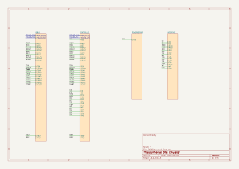
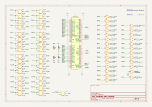
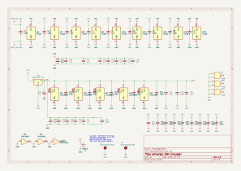
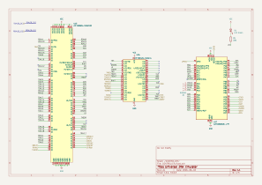
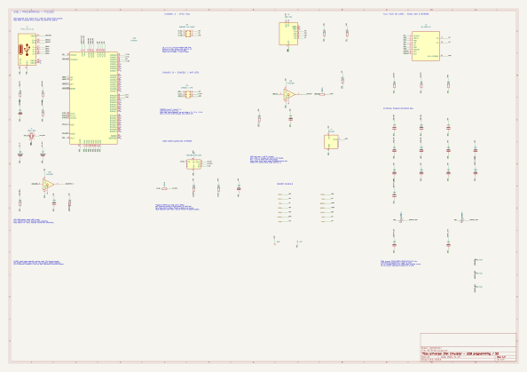

# DISK Emulator

## Introduction
The Q-BUS is a bus created by DEC and was first used for small PDP-11 systems like the LSI-11. There were several backplanes available from DEC
and 3rd parties. For a complete PDP-11 system you needed a CPU card, memory, at least a console and some sort of mass storage device. Depending
on the operation sytem you needed additional cards like a line time clock and others.

## Controller Card
This is a Q-BUS board for a Q-BUS PDP-11 system that emulates disk controllers depending on the firmware of the microcontroller and the CPLD design
files. Currently there are two disk controller emulation, a RLV12 controller with four RL01/02 disks attached and a MSCP controller with four units.
The Q-BUS controller provides a command line interface to control the functions and configuration and a SD-Card to store the PDP-11 disk images.

## Current revision

The original Q-bus design has been updated in three areas:

- **USB and programming:** the FT230X interface is replaced by a dual-channel FT2232H. Channel A connects to the ATF1508/ATF1504 JTAG chain; channel B selects between the AVR serial console and UPDI programming using jumpers. USB and board ground are now common, and the USB interface uses board power.
- **Components and sourcing:** distributed tantalum bypass capacitors are replaced by ceramics. The original LM1117 regulator is retained, with a 22 µF/16 V tantalum at its output and another at the incoming 5 V supply. The SD socket footprint is reused from the HP21xx paper-tape emulator, the USB-C connector is updated, and unused J8 is removed. The [BOM](bom/README.md) contains LCSC numbers, prioritizes JLCPCB Basic parts and consolidates component values.
- **CPLD sources and builds:** the two Q-bus CUPL designs now also have VHDL versions. Independent PLD and VHDL frontends feed a shared canonical TT2 backend and produce byte-identical JEDEC files. Symbolic checks verify all 353 logic/control equations against raw CUPL netlists. The shared backend changes the original PLD build too; the matched images differ from the earlier direct WinCUPL outputs.

Firmware, CPLD sources and build tools are maintained as Git submodules:

| Directory | Contents |
| --- | --- |
| [MSCPEmu-v4-0](MSCPEmu-v4-0/) | AVR firmware |
| [DISKEmu-v5-1-CPLD](DISKEmu-v5-1-CPLD/) | Original CUPL, VHDL translations and equivalence checks |
| [tools/atf15xx-yosys-docker](tools/atf15xx-yosys-docker/README.md) | Docker build tools: GHDL/Yosys, command-line CUPL and Atmel fitters under Wine |

**PCB status:** the schematic and BOM are updated, but the PCB still needs the revised components applied, placed and routed, followed by DRC. Only J8 has been removed directly from the PCB. The revised electronics and onboard programming interfaces have not been tested on hardware. See the [schematic revision notes](docs/schematic-update.md) for details.


## Schematic

The KiCad project, schematic sheets, PCB and local symbol/footprint libraries are grouped in [DISKEmu-QBUS](DISKEmu-QBUS/). Open [DISKEmu-v5-1.kicad_pro](DISKEmu-QBUS/DISKEmu-v5-1.kicad_pro) in KiCad.

The updated FT2232H/UPDI schematic is available as a [PDF](docs/schematic-usb-programming.pdf), with [capacitor specifications and programming jumper instructions](docs/schematic-update.md). The images below are exported from the current schematic; click a sheet to open the scalable drawing.

The [purchasing BOM and JLCPCB sourcing notes](bom/README.md) include LCSC numbers, Basic/Extended classifications, inventory checks and assembly exceptions.

[](docs/schematics/DISKEmu-v5-1.svg)

[](docs/schematics/DISKEmu-v5-1-QBUS.svg)

[](docs/schematics/DISKEmu-v5-1-POWER&SPARE.svg)

[](docs/schematics/DISKEmu-v5-1-CONTROLLER.svg)

[](docs/schematics/DISKEmu-v5-1-INTERFACE.svg)

## CPLD builds

The [CPLD build instructions](DISKEmu-v5-1-CPLD/BUILD.md) describe independent CUPL and VHDL builds that produce byte-identical JEDEC files through a shared canonical netlist backend. With Docker running:

```sh
make toolchain
make -j4 jed-cupl jed-vhdl
make compare-jed
make check-equations
```

JEDEC files and reports are generated separately under the CPLD submodule’s `build/cupl/` and `build/vhdl/` directories. `make cpld-test` checks the canonicalizer, symbolic equation equivalence and final output identity.

## AVR firmware builds

The [AVR firmware container](tools/avr-firmware/README.md) builds both MSCP and RLV12 images for the AVR128DB48 using pinned AVRASM2, device definitions and the original author's shared assembly/FAT library. With Docker running:

```sh
make firmware-toolchain
make firmware
make firmware-repro
```

Programming images are `build/firmware/mscp/diskemu-mscp.hex` and `build/firmware/rlv12/diskemu-rlv12.hex`; full flash `.bin` files, listings, maps and provenance manifests accompany them. Both variants assemble without errors or warnings. Repeated HEX/BIN builds match byte for byte, with a fixed embedded timestamp. Memory/address checks pass, but no known-good binary or hardware test establishes functional correctness yet. The firmware also includes a one-symbol correction to use the official 24 MHz clock constant.

## Additional Information

For a full description of this and other projects related not only to PDP-11 
see my [Home Page](https://www.5volts.ch/). For a detailed description of the
DISK Emulator see [MSCP Emulator](https://www.5volts.ch/pages/mscpemulator)

CPLD programming support uses Project Bureau and OpenOCD with FT2232H channel A.
After building the toolchain and JEDEC files, run `make cpld-svf` and
`make cpld-jtag-check` without hardware. With a powered board connected,
`make cpld-scan` identifies the chain and `make cpld-program` programs both chips.
Programming automatically uses a temporary native OpenOCD bridge on macOS; Linux
uses direct container USB with `ATF15XX_USB_DEVICE` selecting the adapter.
See the [programming guide](tools/atf15xx-yosys-docker/PROGRAMMING.md) for USB access
and jumper settings. Hardware programming has not yet been tested.
